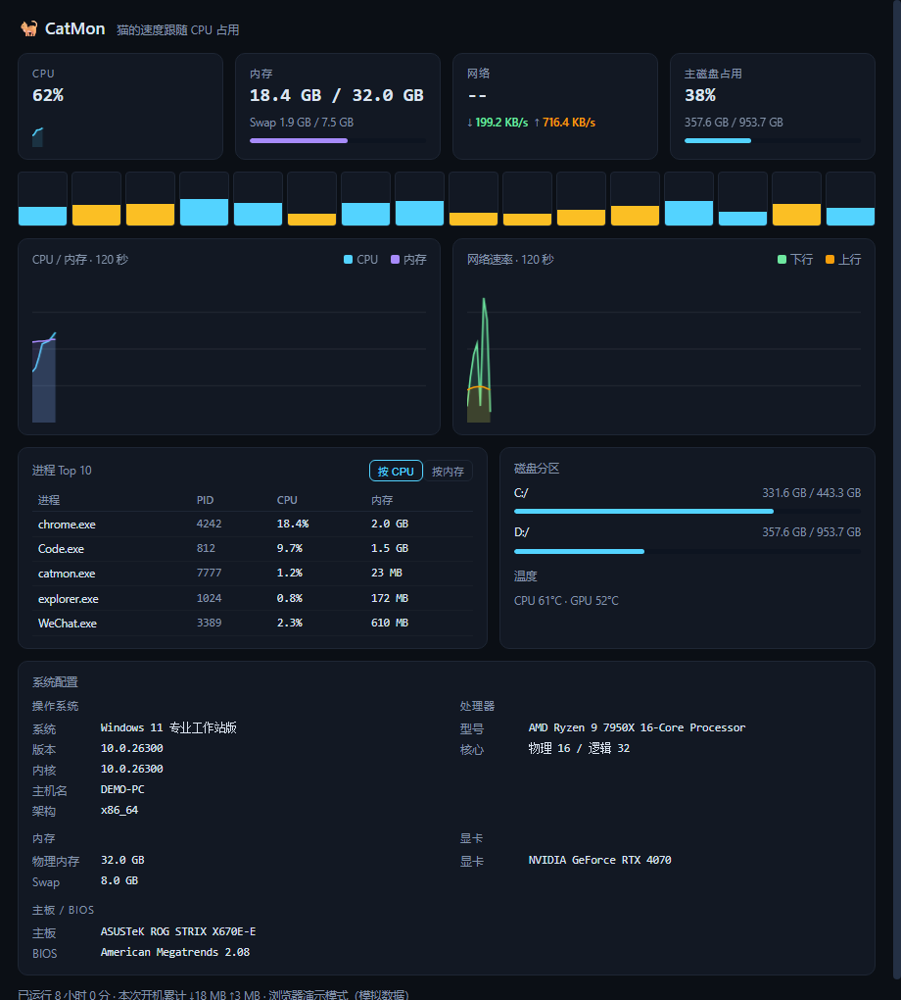

# CatMon 🐈 — 会跑的系统监视器

RunCat 的开源复刻 + 增强：托盘里有一只随系统负载起跑/慢走的小猫，附带一个实时监控面板。Tauri 2 + Rust，跨 Windows / macOS / Linux。



- **托盘角色动画速度 ↔ 系统指标**：CPU / 内存 / 网络速率三选一（托盘右键菜单切换），负载越高跑越快；单色墨稿风格，墨色随任务栏深浅自动适配（深色任务栏浅墨、浅色任务栏深墨，运行中每 5 分钟重检）
- **开机自启**：托盘菜单勾选即可（写入 HKCU Run 键，无需管理员；面板隐藏时事件静默）
- **桌面悬浮球**（默认关闭，托盘菜单「显示悬浮球」开启）：84px 常顶透明圆环，外圈 CPU、内里内存小字；拖动移动、左键开关监控面板、右键隐藏；配置持久化随启动恢复
- **清理页**（对标 CCleaner / CleanMyMac 常用能力，监控/清理双页签）：
  - 文件垃圾：用户/系统临时文件、**浏览器缓存**（Chrome/Edge/Brave/Firefox）、缩略图缓存、回收站、**系统垃圾**（崩溃转储/Minidump/WER 错误报告/Windows Update 下载缓存）、**开发工具缓存**（pip/npm/yarn/pnpm/cargo）
  - 注册表/隐私（保守判据，只清用户级 HKCU）：MuiCache 死项、卸载残留（`winget` 等 PATH 命令视为有效不误删）、App Paths 死链、**隐私痕迹**（最近文档、运行框历史、打开/保存记录）
  - ★注册表删除前自动导出 .reg 备份到 `%APPDATA%/dev.catmon.app/clean-backups/`，双击即可还原
  - **启动项管理**：HKCU/HKLM Run + 用户/全体用户启动文件夹；用户级可删（带备份），全体用户项标注需管理员
  - **大文件查找**：桌面/下载/文档/视频/图片里 ≥100MB 的文件 Top40（只列出不自动删）
  - **维护**：刷新 DNS 缓存
  - CLI 验证：`catmon --clean-scan` / `--clean-exec temp,uninstall` / `--startup-scan` / `--bigfiles`
- **角色可换**：
  - 内置：猫（4 帧）、幽灵、火箭、数字 CPU%（托盘直接显示百分比 + 底部进度条）
  - 自定义：把任意 PNG 帧放进 `%APPDATA%/dev.catmon.app/sprites/<名字>/01.png 02.png …`（文件名排序即帧序），重启生效，菜单里出现「xxx（自定义）」
- **监控面板**（托盘左键开关；点 X 只是隐藏，托盘常驻）：
  - CPU / 每核心负载条 / 内存+Swap / 网络上下行（120 秒曲线）
  - 磁盘分区用量、进程 Top10（按 CPU 或内存）、温度（系统提供时显示）
  - **系统配置（CPU-Z 级硬件信息）**：操作系统版本/内核/主机名、CPU 型号/物理逻辑核数/插槽/基准频率/家族型号步进/指令集（SSE·AVX·AVX2·AVX-512 等，CPUID 直读）/缓存 L1·L2·L3（CPUID 确定性缓存叶）；内存条明细（插槽/容量/代数/配置频率/厂商/件号，Windows）；显卡/驱动版本/分辨率；主板与 BIOS 版本及日期。CPU 卡实时显示每核频率区间（Windows: PDH 计数器 `% Processor Performance` × 标称频率，Linux: /proc/cpuinfo）。Windows 走 PowerShell CIM（CREATE_NO_WINDOW 不闪黑框），Linux 走 lspci+DMI+lscpu，macOS 暂不采集外设明细
  - 与 CPU-Z 的差距（OS 不暴露，做不了）：跑分基准、实时电压、完整 SPD 时序（tRCD/tRP/tRAS）、制程/TDP 数据库、芯片组型号
- 托盘悬浮提示每 5 秒刷新：`CPU 32% · 内存 61% · ↓1.2MB/s ↑0.3MB/s`

## 构建（Windows）

```bash
cd catmon
cargo run -p neko-sprite --bin gen-icons   # 生成 src-tauri/icons/（已随仓库提交，可跳过）
cargo build --release -p catmon
# 产物: target/release/catmon.exe
```

调试运行：`cargo run -p catmon`。指标链路自检：`cargo run -p catmon -- --selftest`。

## 其他平台

- **macOS**：装 Xcode Command Line Tools 后同样 `cargo build --release -p catmon`；应用以纯托盘模式运行（不进 Dock）
- **Linux**：需要 GTK + libayatana-appindicator 运行库（Debian/Ubuntu: `libayatana-appindicator3-dev librsvg2-dev`）

## 配置

`%APPDATA%/dev.catmon.app/config.json`（macOS/Linux 在对应 app data 目录）：

```json
{ "character": "cat", "metric": "cpu", "paused": false }
```

## 目录结构

```
catmon/
├── crates/neko-sprite/    # 程序化角色绘制（无外部素材）+ 图标生成器
├── src-tauri/             # Tauri 应用：指标采样 / 托盘动画 / 面板窗口
└── ui/                    # 监控面板（纯静态 HTML，无 npm 依赖；浏览器直开为演示模式）
```

## 路线图

- ~~开机自启~~（已完成，托盘菜单勾选）
- 电池指标、磁盘 IO 速率、GIF 直接导入为角色、应用级网速（按进程）、完整 SPD 内存时序
- 清理执行进度条、启动项禁用/恢复切换

## 迭代日志

- [ROUNDS.md](ROUNDS.md)：40 轮自我迭代记录（每轮改什么、怎么验证的）
